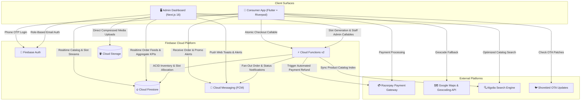
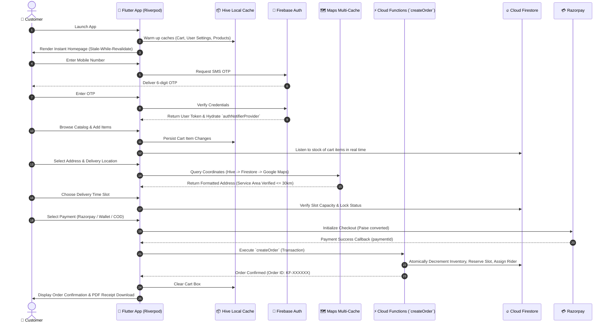
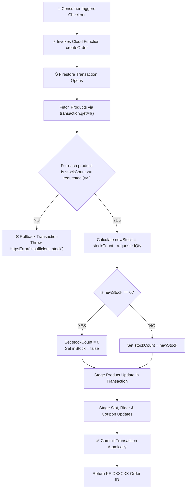
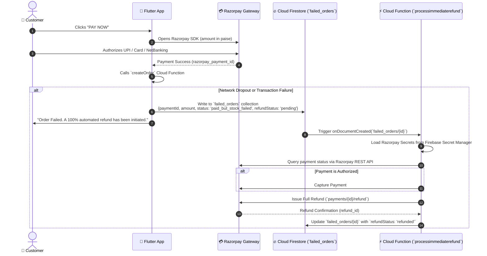
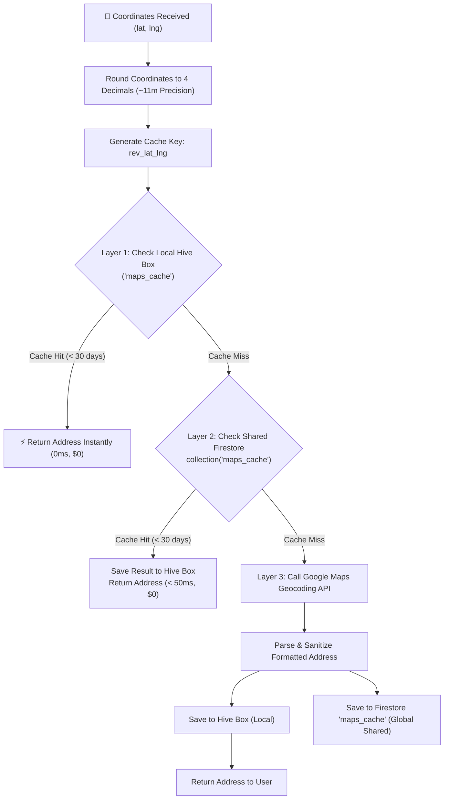

<div align="center">
  

  # 🛒 Kissan Fresh — Enterprise E-Commerce & Logistics Ecosystem

  **A High-Performance, Real-Time Farm-to-Fork Commerce Platform.**  
  *Engineered with Flutter & Riverpod for Consumers, Next.js 16 & React 19 for Operations, and an Event-Driven Serverless Firebase Backend.*

  ---

  [](https://flutter.dev/)
  [](https://riverpod.dev/)
  [](https://nextjs.org/)
  [](https://react.dev/)
  [](https://tailwindcss.com/)
  [](https://firebase.google.com/)
  [](https://www.algolia.com/)
  [](https://razorpay.com/)
  [](https://cloud.google.com/maps-platform/)
  [](#)
  [](https://shorebird.dev/)
</div>

---

## 📑 Table of Contents

1. [Executive Ecosystem Architecture](#-executive-ecosystem-architecture)
2. [System Topology & Data Flow](#-system-topology--data-flow)
3. [📱 Module 1: Consumer Mobile Application (Flutter & Riverpod)](#-module-1-consumer-mobile-application-flutter--riverpod)
   - [Riverpod Reactive State Architecture](#riverpod-reactive-state-architecture)
   - [Complete Customer Journey & Flow Matrix](#complete-customer-journey--flow-matrix)
   - [Dynamic Catalog & Merchandising Pipeline](#dynamic-catalog--merchandising-pipeline)
   - [Smart Cart & Dynamic Pricing Engine](#smart-cart--dynamic-pricing-engine)
   - [Voice & Debounced Catalog Search](#voice--debounced-catalog-search)
   - [Delivery Slot Booking Engine](#delivery-slot-booking-engine)
   - [PDF Invoicing & Offline Order History](#pdf-invoicing--offline-order-history)
4. [🖥️ Module 2: Operations Control Panel (Next.js 16 & React 19)](#-module-2-operations-control-panel-nextjs-16--react-19)
   - [Architecture & Tech Stack](#architecture--tech-stack)
   - [Staff Authentication & Granular RBAC](#staff-authentication--granular-rbac)
   - [Real-Time Executive Analytics](#real-time-executive-analytics)
   - [Dual-Catalog Product Management](#dual-catalog-product-management)
   - [Dedicated Stock Management & Bulk Operations](#dedicated-stock-management--bulk-operations)
   - [Fleet & Dynamic Delivery Slot Engine](#fleet--dynamic-delivery-slot-engine)
   - [Live Order Logistics & Dispatch](#live-order-logistics--dispatch)
   - [Algolia Instant Search Integration](#algolia-instant-search-integration)
   - [Broadcast Offer Campaigns](#broadcast-offer-campaigns)
   - [Dynamic Theme Engine & Audit Logging](#dynamic-theme-engine--audit-logging)
5. [⚡ Deep Technical Implementations](#-deep-technical-implementations)
   - [1. Firebase Optimization & Query Cost Architecture](#1-firebase-optimization--query-cost-architecture)
   - [2. Atomic Stock Management & Inventory Consistency](#2-atomic-stock-management--inventory-consistency)
   - [3. Transactional Order Creation Pipeline (`createOrder`)](#3-transactional-order-creation-pipeline-createorder)
   - [4. Razorpay Integration & Automated Failure Compensation](#4-razorpay-integration--automated-failure-compensation)
   - [5. Firebase Cloud Messaging (FCM) & Multi-Channel Notifications](#5-firebase-cloud-messaging-fcm--multi-channel-notifications)
   - [6. Multi-Layer Caching for Google Maps](#6-multi-layer-caching-for-google-maps)
   - [7. Local Caching Strategy & Stale-While-Revalidate UX](#7-local-caching-strategy--stale-while-revalidate-ux)
   - [8. Realtime Synchronization & Event Handling](#8-realtime-synchronization--event-handling)
6. [🛡️ Security Architecture & Firestore Rules](#-security-architecture--firestore-rules)
7. [📂 Project Structure](#-project-structure)
8. [🚀 Setup & Environment Configuration](#-setup--environment-configuration)

---

## 🏛️ Executive Ecosystem Architecture

The **Kissan Fresh** ecosystem is an enterprise-ready, multi-client, cloud-native delivery platform. Built to eliminate single points of failure and streamline perishable grocery operations, it unites two dedicated primary surfaces backed by a shared serverless infrastructure:

```
┌────────────────────────────────────────────────────────────────────────────────────────┐
│                                  KISSAN FRESH ECOSYSTEM                                │
└────────────────────────────────────────────────────────────────────────────────────────┘
          │                                                               │
          ▼                                                               ▼
┌───────────────────────────────────────┐               ┌───────────────────────────────────────┐
│     CONSUMER MOBILE APPLICATION       │               │      ADMIN OPERATIONS DASHBOARD       │
│  - Flutter (iOS & Android)            │               │  - Next.js 16 (App Router) + React 19 │
│  - Riverpod State Architecture        │               │  - Zustand Global Stores              │
│  - Hive Local Storage (7 Boxes)       │               │  - Tailwind CSS v4 + shadcn/ui        │
│  - Multi-Layer Maps Caching           │               │  - TanStack Table v8 + Recharts       │
│  - Razorpay SDK + Wallet Integration  │               │  - Algolia Instant Search Engine      │
│  - Shorebird OTA Dart Code Push       │               │  - Browser Client Image Compression   │
└───────────────────────────────────────┘               └───────────────────────────────────────┘
          │                                                               │
          └───────────────────────────────┬───────────────────────────────┘
                                          │
                                          ▼
┌────────────────────────────────────────────────────────────────────────────────────────┐
│                        SERVERLESS BACKEND ENGINE (FIREBASE v2)                         │
│  - Cloud Firestore: Distributed NoSQL Database with ACID Transactions                  │
│  - Cloud Functions v2: Event Triggers & Authenticated HTTPS Callables                  │
│  - Firebase Auth: Phone/SMS OTP for Shoppers | Email & Password for Staff              │
│  - Firebase Cloud Messaging (FCM): Topic-Based Broadcasts & Direct Alerts              │
│  - Firebase Storage: Product Assets, Hero Media & Compressed Receipts                 │
│  - Firebase App Check: Device Attestation via Google Play Integrity & App Attest       │
│  - Third-Party Integrations: Razorpay Webhooks/Refunds & Google Maps Platform API      │
└────────────────────────────────────────────────────────────────────────────────────────┘
```

---

## 🌐 System Topology & Data Flow



---

## 📱 Module 1: Consumer Mobile Application (Flutter & Riverpod)

### Riverpod Reactive State Architecture

The Consumer Storefront adopts **Riverpod 2.x** for strict compile-time safety, seamless testability, and zero service-locator coupling.

```
┌────────────────────────────────────────────────────────────────────────────────────────┐
│                               RIVERPOD ARCHITECTURE LAYOUT                             │
└────────────────────────────────────────────────────────────────────────────────────────┘
                                 
      UI Presentation Layer (Widgets / Screens)
         │           ▲
         │ ref.read  │ ref.watch (Auto-rebuild on state change)
         ▼           │
     StateNotifierProvider / AsyncNotifierProvider Layer
     (CartNotifier, AuthNotifier, CatalogNotifier, SlotNotifier)
         │           ▲
         │ Invokes   │ Emits immutable state
         ▼           │
     Domain Repositories & Infrastructure Services
     (FirestoreService, HiveCacheService, MapsCacheService, RazorpayService)
         │           ▲
         │ Queries   │ Stream / Future
         ▼           │
     Data Sources: Cloud Firestore / Hive NoSQL / Device Hardware (GPS)
```

#### Key Riverpod Providers in the App:
* **`authNotifierProvider`**: Manages phone authentication state, session verification, user profile synchronization, and auto-routing.
* **`cartNotifierProvider`**: Manages immutable `CartState` (items, quantities, subtotals, applied coupons, delivery fees, wallet deductions). Subscribes directly to Firestore product streams to auto-reconcile stock and price shifts in real time.
* **`catalogNotifierProvider`**: Handles dual-catalog streams (`kissan-fresh` vs. `home-food`), cursor-based pagination, dynamic category filtering, and category-level caching.
* **`slotSelectionProvider`**: Streams dynamic slot documents, validates capacity locks, and computes active delivery dates.
* **`mapsCacheServiceProvider`**: Exposes address autocomplete, reverse geocoding, and distance calculations through a 3-tier cache.
* **`ordersStreamProvider`**: Real-time snapshot listener delivering order state updates directly to the customer's timeline.

---

### Complete Customer Journey & Flow Matrix



---

### Dynamic Catalog & Merchandising Pipeline

* **Dual Catalog Architecture**: Instant switching between `kissan-fresh` (perishable farm produce, fruits, vegetables, daily groceries) and `home-food` (fresh kitchen pre-orders).
* **Homepage Merchandising Rails**:
  * **Today's Specials**: Date-keyed Firestore configuration document (`todays_specials/YYYY-MM-DD`). Up to 30 product references fetched in a single bounded `whereIn` query and preserved in display order.
  * **Dynamic Sections**: Ranked merchandising groups fetched with a concurrency limiter (max 3 concurrent category queries). UI updates in batches to eliminate layout flutter.
  * **Visual Category Navigators**: Top carousel mapped directly to catalog collections with 6-hour local TTL caching.
* **Product Detail Screen**:
  * Multi-variation picker (e.g., 250g, 500g, 1kg, 5kg).
  * Real-time stock status badge (In Stock, Low Stock, Sold Out).
  * Image carousel with pinch-to-zoom.
  * Contextual "Similar Products" rail based on category and tags.

---

### Smart Cart & Dynamic Pricing Engine

* **Variation-Aware Line Items**: Line IDs uniquely hashed as `${productId}_${variationId}` to handle independent prices, MRPs, and stock thresholds for different packaging sizes.
* **Dynamic Delivery Fee Calculation**:
  $$\text{Delivery Fee} = \begin{cases} ₹0, & \text{if Subtotal} \ge ₹300 \\ ₹30, & \text{if Subtotal} < ₹300 \end{cases}$$
* **Intelligent Coupon Engine**:
  * Supports fixed discounts (e.g., flat ₹50 off) and percentage discounts (e.g., 10% off up to ₹100).
  * Scope validation: Global cart, category-specific, or single-product applicability.
  * Threshold checks: Minimum order spend validation and per-user lifetime use counter enforcement.
* **Kissan Wallet Split Checkout**:
  * Consumers can apply their live wallet balance to offset order totals.
  * Supports 100% wallet coverage (skips payment gateway) or split payment (wallet deduction + Razorpay online gateway for the remaining balance).
* **Live Stock Sentry**:
  * When opening the checkout screen, the app fires a real-time validation against Firestore snapshots. If an item sells out in another user's transaction, the cart is flagged, the user is warned with an actionable dialog, and checkout is disabled.

---

### Voice & Debounced Catalog Search

* **High-Speed Debounced Text Search**: 300ms debounce on keystrokes to prevent unnecessary query thrashing.
* **Stemming & Plural Normalization**: Custom token parser stripping common suffixes (`s`, `es`, `ies`) so searching "tomatoes" instantly surfaces "tomato".
* **Speech-to-Text Integration**: Hands-free voice search powered by `speech_to_text` with Indian English (`en_IN`) acoustic models and auto-stop on 3-second speech silence.
* **Zero-Latency In-Memory Query Cache**: Query/category pairs are cached in memory during active app sessions for instant back-navigation.
* **Persistent Recent Searches**: Top 5 searches serialized locally to `SharedPreferences` with one-tap clearing.

---

### Delivery Slot Booking Engine

* **Dynamic Date Grouping**: Organizes slots into intuitive date tabs (`Today`, `Tomorrow`, and upcoming dates).
* **Capacity & Lock Awareness**:
  * Each slot documents total maximum capacity and current allocated orders.
  * Real-time listener greys out locked slots or fully booked slots (`assignedOrders >= capacity`).
* **Cut-Off Intelligence**: Automatically hides time windows that have already passed for the current operating day.

---

### PDF Invoicing & Offline Order History

* **Vector PDF Generator**: Powered by the Dart `pdf` and `printing` libraries, synthesizing high-fidelity tax invoices containing:
  * Brand logo and header metadata.
  * Customer details, delivery address, and time slot.
  * Itemized product breakdown (unit, quantity, MRP, selling price, line totals).
  * Subtotal, coupon savings, delivery charges, and final paid amount.
  * Razorpay payment transaction IDs and status indicators.
* **Offline Order Mirroring**: Orders are snapshotted to Hive (`orders_cache`), allowing users to inspect past orders, items, and receipts even with zero cellular connectivity.

---

## 🖥️ Module 2: Operations Control Panel (Next.js 16 & React 19)

### Architecture & Tech Stack

The Kissan Fresh Operations Dashboard is a modern, responsive web application engineered for high-throughput logistics management:

* **Next.js 16 (App Router)**: Utilizing React Server Components (RSC) for initial page loads and Client Components for dense real-time operational views.
* **React 19**: Modern concurrent features, action hooks, and optimized re-renders.
* **Tailwind CSS v4 & shadcn/ui**: Accessible, responsive component library built on Radix primitives.
* **Zustand**: Decoupled, lightweight global client state management.
* **TanStack Table v8**: Virtualized, sortable, filterable data tables handling hundreds of live orders and inventory rows with zero UI latency.
* **Recharts**: Responsive SVG charting engine for visual analytics.
* **Algolia Search**: Sub-millisecond indexed product catalog search with faceted category filtering.

---

### Staff Authentication & Granular RBAC

* **Authentication**: Firebase Authentication with strict email/password credentials and persistent session state.
* **Role Hierarchy**:
  * `ADMIN`: Unrestricted master privileges across all financial, catalog, staff, and system configuration modules.
  * `MANAGEMENT`: Granular, permission-governed operational staff access.
* **Granular Permission Matrix**:
  * `products`: Create, edit, and delete catalog items.
  * `stock`: Quick-edit inventory levels, set out-of-stock flags, execute bulk stock additions.
  * `orders`: Manage dispatch statuses, assign riders, reschedule delivery slots, cancel orders.
  * `riders`: Add/remove fleet delivery riders, update vehicle info and phone numbers.
  * `slots`: Configure delivery operating hours, manually generate slot rosters, lock slots.
  * `coupons`: Create promotions, set minimum spends and usage quotas.
  * `offers`: Broadcast push notifications and instant flash promotions.
  * `theme`: Customize mobile app branding, hex colors, and hero banners.
  * `reports`: Access and download financial summaries and Excel audit spreadsheets.
  * `audit_logs`: View immutable staff activity history.
* **Secure Staff Administration**: Creating new staff accounts or updating credentials is restricted to Cloud Functions (`createUser`, `updateUserPassword`) ensuring credentials cannot be manipulated directly via client SDKs.

---

### Real-Time Executive Analytics

* **Server-Side Aggregate Queries**: Utilizes Firestore server-side `count()` and `sum(totalAmount)` aggregates to compute real-time KPIs without downloading raw collections to the browser.
* **Parallel Execution Engine**: Five independent metric queries run concurrently via `Promise.all`:
  1. Gross Delivered Revenue ($\sum \text{totalAmount}$).
  2. Total Order Volume ($\text{count}$).
  3. Active Orders Pending Dispatch.
  4. Out-of-Stock SKUs.
  5. Active Fleet Riders On Duty.
* **Dynamic Sales Charting**: Time-series revenue and order volume curves rendered across 7, 30, and 90-day intervals with missing-date auto-fill.
* **Live Orders Ticker**: Bounded real-time listener displaying the 10 most recent orders with visual status pulses.

---

### Dual-Catalog Product Management

* **Unified Origin Filtering**: Seamless toggling between Kissan Fresh and Home Food catalogs.
* **Multi-Variation Manager**:
  * Manage multiple SKU configurations per product (e.g., 500g, 1kg, Box of 6).
  * Auto-calculates discount percentages dynamically:
    $$\text{Discount \%} = \left( \frac{\text{MRP} - \text{Price}}{\text{MRP}} \right) \times 100$$
* **Client-Side Image Compression**:
  * Employs `browser-image-compression` to resize and compress uploaded product images directly in the browser before sending to Firebase Storage.
  * Eliminates bandwidth waste and keeps storage payloads under 500 KB per asset.
* **Tag & Category Taxonomy**: Multi-tag tagging for search indexing, nutrition badges, and origin categorization.

---

### Dedicated Stock Management & Bulk Operations

* **Flattened Stock Data Grid**: Denormalizes products and their variations into dedicated inventory rows for rapid editing.
* **Bulk Stock Adjustments**: Multi-select any combination of SKUs to apply positive or negative stock adjustments in a single batch operation.
* **Automatic In-Stock Derivation**: Adjusting inventory automatically updates the boolean `inStock` property, keeping catalog listings and customer search perfectly in sync.
* **Granular Security Boundary**: Staff assigned only the Stock Management permission are restricted by Firestore Rules to modify only `stockCount`, `inStock`, `variations`, and `updatedAt`, preventing unauthorized edits to prices or product descriptions.

---

### Fleet & Dynamic Delivery Slot Engine

* **Rider Registry**: Onboard riders with vehicle registration details, contact numbers, and duty status.
* **Automated Capacity Model**:
  $$\text{Slot Capacity} = \text{Active Fleet Riders} \times 6\text{ orders per rider}$$
* **Interactive Slot Roster**:
  * Real-time monitoring of all hourly slots for today and tomorrow.
  * Live progress bars indicating allocated orders vs. maximum rider capacity.
  * Quick-lock switch to freeze incoming orders for a specific slot during weather or logistical emergencies.
  * Individual rider assignment/reassignment per time slot.
* **Manual Slot Generation Trigger**: Emergency admin override to regenerate or extend delivery windows for any selected date via callable Cloud Function `manualGenerateSlots`.

---

### Live Order Logistics & Dispatch

* **Order Board**: Live TanStack Table feed displaying order number, customer name, delivery slot, address, rider, total, and payment type.
* **Interactive Status Timeline**:
  * Visual stepper transitioning orders through:
    $$\text{Processing} \longrightarrow \text{Confirmed} \longrightarrow \text{Out for Delivery} \longrightarrow \text{Delivered} \ (\text{or Cancelled})$$
* **Atomic Slot & Rider Reassignment**:
  * If a rider is unavailable, administrators can reassign the order to an alternate rider or move it to a different slot.
  * Handled via a Firestore transaction that atomically decrements the prior rider/slot counter and increments the new target counter.
* **Thermal & A4 Invoice Printing**: Direct integration with `react-to-print` for one-click packing slips and delivery invoices.

---

### Algolia Instant Search Integration

* **Instant Typo-Tolerant Search**: Searches across titles, descriptions, categories, and tags with results delivered in under 20 milliseconds.
* **Automatic Cloud Function Synchronization**:
  * `syncProductToAlgolia` Cloud Function listens to Firestore `products` write triggers.
  * Automatically creates, updates, or deletes Algolia index records when products are edited in the dashboard.
* **Batch Re-indexing Script**: Standalone automation tool (`sync-algolia.mjs`) for dry-runs, complete index rebuilding, and ranking rule configuration.

---

### Broadcast Offer Campaigns

* **Campaign Composer**: Rich push notification creator with title, promotional body, banner URL, and destination deep link.
* **Instant vs. Scheduled**:
  * **Instant**: Dispatches immediately via Cloud Function `onInstantOfferCreated` to the FCM `all_users` topic.
  * **Scheduled**: Enqueues notification documents processed by a 4-hour scheduled runner (`processScheduledOffers`).
* **Campaign History & Audit**: Tracks status (`SENT`, `PENDING`, `FAILED`) and records failure logs.

---

### Dynamic Theme Engine & Audit Logging

* **Server-Driven App Theming**:
  * Operations can configure dynamic brand themes (e.g., Summer Fresh, Diwali Festival, Monsoon Greens).
  * Validates 6-digit hex color inputs and uploads seasonal hero banners.
  * Mobile app listens live to theme documents, updating its aesthetic palette instantly without requiring app updates.
* **Immutable Audit Trail**:
  * Every critical action (price changes, manual refunds, stock edits, cancellations) automatically logs an append-only entry to `audit_logs`.
  * Logs authenticated staff UID, email, timestamp, entity ID, action type, and before/after payloads.
  * Exportable to Excel (`.xlsx`) for accounting and regulatory compliance.

---

## ⚡ Deep Technical Implementations

### 1. Firebase Optimization & Query Cost Architecture

To ensure high performance while controlling Cloud Firestore read/write costs, the codebase implements strict optimization patterns:

| Optimization Strategy | Implementation Location | Technical Mechanism |
|---|---|---|
| **Bounded Reads** | Consumer App & Admin Dashboard | Every high-traffic query enforces an explicit `.limit(n)` constraint (e.g., 18 for catalog pages, 10 for recent orders, 5 for section previews). |
| **Cursor Pagination** | Products, Orders, Audit Logs | Uses `.startAfterDocument(lastDoc)` for forward-only infinite scrolling, completely eliminating high-offset skip reads. |
| **Server-Side Aggregates** | Admin Dashboard (`/dashboard`) | Uses Firestore `count()` and `sum(totalAmount)` APIs. Executes on server metadata without transferring order documents to client browsers. |
| **Parallel I/O Concurrency** | Dashboard & App Startup | `Future.wait` and `Promise.all` execute independent network reads concurrently. Category previews are throttled to a concurrency bound of 3 to prevent thread starvation. |
| **Batched Document Reads** | Product/Cart Revalidation | Uses `whereIn` queries (chunked in groups of 10-30 IDs) and transactional `transaction.getAll()`, transforming what would be $N$ queries into a single round-trip. |
| **Stale-While-Revalidate** | Catalog & Categorized Rails | Restores local cached documents from Hive instantly on startup, then attaches a single real-time snapshot listener to refresh the first page. |
| **Write Batch Partitioning** | Slot Generation & Merchandising | Batches mutations using `db.batch()` and automatically commits before hitting the 500-operation ceiling (enforcing an internal threshold of 400 operations). |

---

### 2. Atomic Stock Management & Inventory Consistency

To prevent overselling perishable goods during flash promotions or peak hours, inventory is managed atomically:



* **Variation-Level Stock Precision**: If an order item specifies a `variationId`, the transaction traverses the product's `variations` array, validates the specific variation's stock, decrements it, and sets `inStock = false` on both the variation and the parent product if total stock reaches zero.
* **Client-Side Live Sentry**: While browsing, the cart controller maintains a stream listener on active cart IDs. If another user buys out an item, the cart reflects the change immediately.

---

### 3. Transactional Order Creation Pipeline (`createOrder`)

The core business logic executes inside a single ACID Firestore transaction within the `createOrder` Cloud Function (`functions/index.js`):

```javascript
// Architecture of the transactional createOrder Cloud Function
exports.createOrder = onCall({ region: "us-central1" }, async (request) => {
  // 1. Authenticate Request
  if (!request.auth) throw new HttpsError("unauthenticated", "User must be logged in");
  const userId = request.auth.uid;
  const { order: orderData } = request.data;

  // 2. Enforce Service Geofence (30km Radius)
  if (orderData.latitude && orderData.longitude) {
    const distance = getDistance(STORE_LAT, STORE_LNG, orderData.latitude, orderData.longitude);
    if (distance > 30.0) {
      throw new HttpsError("failed-precondition", "Delivery address is outside our 30km service area.");
    }
  }

  return await db.runTransaction(async (transaction) => {
    // 3. Batch Read Products (Preventing N+1)
    const productRefs = deduplicatedProductIds.map(id => db.collection("products").doc(id));
    const productDocs = await transaction.getAll(...productRefs);

    // 4. Validate & Atomically Decrement Inventory
    for (const item of orderData.items) {
      const pDoc = productDocs.find(d => d.id === item.productId);
      if (!pDoc.exists) throw new HttpsError("not-found", `Product ${item.title} no longer exists`);
      // Validate available stock & decrement
    }

    // 5. Validate Slot Capacity & Lock Status
    const slotRef = db.collection("slots").doc(orderData.slotId);
    const slotDoc = await transaction.get(slotRef);
    if (!slotDoc.exists || slotDoc.data().isLocked) {
      throw new HttpsError("failed-precondition", "Selected delivery slot is no longer available");
    }

    // 6. Intelligent Least-Loaded Rider Assignment
    const riderSnapshot = await transaction.get(
      slotRef.collection("riders").where("assignedOrders", "<", 6).orderBy("assignedOrders", "asc").limit(1)
    );
    const assignedRiderId = riderSnapshot.docs[0].id;

    // 7. Atomic Coupon Usage Increment
    if (orderData.couponCode) {
      // Validate coupon validity & increment totalUses
    }

    // 8. Commit Atomic Mutations
    transaction.update(slotRef, { assignedOrders: FieldValue.increment(1) });
    transaction.update(slotRef.collection("riders").doc(assignedRiderId), { assignedOrders: FieldValue.increment(1) });
    transaction.set(newOrderRef, finalizedOrder);

    return { success: true, orderId: generatedOrderId, riderId: assignedRiderId };
  });
});
```

---

### 4. Razorpay Integration & Automated Failure Compensation

The application guarantees financial integrity through an automated failure compensation state machine:



---

### 5. Firebase Cloud Messaging (FCM) & Multi-Channel Notifications

A multi-tiered push notification engine delivers marketing broadcasts and real-time operational alerts:

```
┌────────────────────────────────────────────────────────────────────────────────────────┐
│                              FCM NOTIFICATION ARCHITECTURE                             │
└────────────────────────────────────────────────────────────────────────────────────────┘

 [Marketing Campaign] ──► Topic Broadcast ('all_users') ──► Fan-out to all Mobile Devices
                                                                  
 [Order Status Change] ──► Firestore Trigger ─────────────► Direct Customer Device Token
                           (onOrderStatusUpdate)
                                                                  
 [New Order Created] ───► Cloud Function ─────────────────► Dashboard Browser FCM Tokens
                           (createOrder commit)            (Foreground Sonner Toasts)
```

#### Key Implementation Details:
* **Topic-Based Fan-Out**: Marketing campaigns target the `all_users` topic, avoiding individual token lookups across thousands of users.
* **Direct Order Tracking**: The customer's device token is saved to `users/{uid}/fcmToken`. Cloud Function `onOrderStatusUpdate` triggers when an order's status transitions, delivering localized alerts (e.g., *"Your order is out for delivery with our rider!"*).
* **Multi-Device Admin Broadcast**: Dispatches new order alerts simultaneously to dashboard browser instances.
* **Automatic Stale-Token Housekeeping**: When `admin.messaging().sendMulticast()` returns errors (`messaging/registration-token-not-registered` or `messaging/invalid-argument`), the function executes a batched delete to remove dead tokens from Firestore.

---

### 6. Multi-Layer Caching for Google Maps

To maintain sub-100ms address loading and minimize Google Maps Platform API costs, address resolution uses a **3-Layer Caching Strategy**:



#### Additional Geocoding Optimizations:
* **150-Meter Movement Threshold**: If a user drags the map pin less than 150 meters from their previously resolved location, geocoding is skipped.
* **800ms Search Debounce**: Map panning and address search queries are debounced by 800ms.
* **Basic Fields Only**: Google Place Details requests strictly restrict fields to `geometry,formatted_address`, remaining within Google's lowest billing tier.

---

### 7. Local Caching Strategy & Stale-While-Revalidate UX

The consumer app initializes **Hive NoSQL** storage at startup, opening 7 specialized boxes in parallel:

```
┌────────────────────────────────────────────────────────────────────────────────────────┐
│                              HIVE LOCAL STORAGE ENGINE                                 │
├──────────────────────┬─────────────────────────────────────────────────────────────────┤
│ Box Name             │ Stored Data & Responsibility                                    │
├──────────────────────┼─────────────────────────────────────────────────────────────────┤
│ `maps_cache`         │ 30-day cached geocoding, autocomplete, and place details        │
│ `cart_box`           │ Persistent shopping cart state & line item selections           │
│ `products_cache`     │ Stale-while-revalidate catalog products & categorized rails     │
│ `orders_cache`       │ Offline-accessible historical order records & invoice data      │
│ `wishlist_box`       │ Saved favorite products for instant heart-icon state            │
│ `user_settings`      │ App preferences, dark/light theme, notification opt-in flags    │
│ `user_activity`      │ Lightweight local recommendation tracker (recent views, count)  │
└──────────────────────┴─────────────────────────────────────────────────────────────────┘
```

#### Stale-While-Revalidate Implementation:
1. **Immediate Paint**: On screen launch, the Riverpod provider reads directly from the Hive box, painting the UI in under 16ms with zero loading spinners.
2. **Background Reconciliation**: Concurrently, the provider attaches a Firestore snapshot listener to fetch fresh data.
3. **Seamless Merge**: When fresh data arrives, it merges with the local cache and updates the UI smoothly without layout shifts.

---

### 8. Realtime Synchronization & Event Handling

* **Reactive Catalog Updates**: Catalog listings subscribe to real-time snapshots. When administrators change prices or archive products in the dashboard, customer displays update immediately.
* **Delivery Slot Locks**: Emergency slot locks configured by dispatchers propagate to all customer devices in real time, disabling affected slot buttons dynamically.
* **Algolia Search Auto-Sync**: Modifying a product in the dashboard fires `syncProductToAlgolia`, updating the Algolia search index in near real time.

---

## 🛡️ Security Architecture & Firestore Rules

Database and storage access is secured via comprehensive security rules:

```
┌────────────────────────────────────────────────────────────────────────────────────────┐
│                               SECURITY RULES ARCHITECTURE                              │
└────────────────────────────────────────────────────────────────────────────────────────┘

  Public (Read-Only)      Owner-Only (Strict)     Role-Based (Staff)      Backend-Only
 ─────────────────────   ─────────────────────   ─────────────────────   ───────────────
  • products              • users/{uid}           • Full access for       • orders
  • categories            • orders (read own)       ADMIN role             (Direct client
  • sections              • failed_orders         • Permission-gated       creation is
  • coupons                 (create-only,           access for             blocked; only
  • todays_specials         strict schema)          MANAGEMENT             callable CF
  • app_config            • profile_images/       • Append-only            can write)
                            {uid}.jpg               audit_logs
```

* **Client Order Creation Block**: Clients cannot write directly to `/orders`. All orders must pass through the `createOrder` Cloud Function for server-side validation.
* **Failed Order Protection**: The `failed_orders` collection requires authenticated ownership, positive numeric amounts, INR currency, and an initial `refundStatus: 'pending'`.
* **Media Storage Quotas**: Firebase Storage rules enforce MIME type restrictions (`image/*`) and file size limits (max 5 MB for catalog assets, max 3 MB for user profile photos).

---

## 📂 Project Structure

```text
kissan-fresh-ecosystem/
│
├── kissan-fresh-app/                       # 📱 CONSUMER MOBILE APP (Flutter & Riverpod)
│   ├── lib/
│   │   ├── main.dart                       # App initialization & Hive setup
│   │   ├── config/                         # Environment & build flavors
│   │   ├── model/                          # Data models (Product, Cart, Order, Slot)
│   │   ├── providers/                      # Riverpod State Notifiers & Providers
│   │   │   ├── auth_provider.dart          # Phone auth & session state
│   │   │   ├── cart_provider.dart          # Cart calculations & stock listener
│   │   │   ├── catalog_provider.dart       # Catalog streams & pagination
│   │   │   └── slot_provider.dart          # Delivery slot availability
│   │   ├── services/                       # Infrastructure service layer
│   │   │   ├── cache_service.dart          # Hive local caching service
│   │   │   ├── location_service.dart       # GPS & location services
│   │   │   ├── maps_cache_service.dart     # 3-tier Google Maps caching
│   │   │   ├── notification_service.dart   # FCM handler & local alerts
│   │   │   └── pdf_receipt_service.dart    # Vector PDF invoice generator
│   │   └── views/                          # UI Screens & Widgets
│   │       ├── screens/                    # Full-page screens (Home, Cart, Checkout)
│   │       └── widgets/                    # Reusable UI components
│   └── pubspec.yaml                        # Flutter dependencies
│
└── KissanFreshDashboard/                   # 🖥️ OPERATIONS DASHBOARD (Next.js 16 & React 19)
    ├── src/
    │   ├── app/                            # Next.js App Router routes
    │   │   ├── dashboard/                  # Authenticated operations surface
    │   │   │   ├── page.jsx                # Executive Analytics & KPIs
    │   │   │   ├── product-management/     # Catalog CRUD & variation editor
    │   │   │   ├── stock-management/       # Bulk stock editor & inventory grid
    │   │   │   ├── order-management/       # Live order board & status dispatch
    │   │   │   ├── slots-management/       # Delivery slot roster & capacity
    │   │   │   ├── rider-management/       # Fleet rider management
    │   │   │   ├── coupon-management/      # Promotional coupon engine
    │   │   │   ├── offers/                 # Push notification broadcaster
    │   │   │   ├── reports/                # Sales reporting & Excel exports
    │   │   │   └── theme-management/       # Dynamic branding & themes
    │   │   ├── login/                      # Staff login screen
    │   │   └── layout.jsx                  # Root layout & theme providers
    │   ├── components/                     # shadcn/ui components & data tables
    │   ├── firebase/                       # Firebase client SDK initialization
    │   ├── store/                          # Zustand global client stores
    │   └── services/                       # API services & Algolia integrations
    ├── functions/                          # ⚡ FIREBASE CLOUD FUNCTIONS (Node.js 24)
    │   ├── index.js                        # Cloud Functions entrypoint
    │   └── package.json                    # Backend dependencies
    ├── firestore.rules                     # Cloud Firestore security rules
    ├── storage.rules                       # Cloud Storage security rules
    └── package.json                        # Dashboard dependencies
```

---

## 🚀 Setup & Environment Configuration

### 1. Consumer Mobile App (`kissan-fresh-app`)

1. **Install Dependencies**:
   ```bash
   cd kissan-fresh-app
   flutter pub get
   ```
2. **Configure Environment (`.env`)**:
   Create a `.env` file in the root of `kissan-fresh-app`:
   ```env
   MAPS_API_KEY=AIzaSyYourGoogleMapsApiKey
   RAZORPAY_API_KEY=rzp_live_YourRazorpayKey
   ```
3. **Launch Application**:
   ```bash
   flutter run -t lib/main_prod.dart
   ```

### 2. Operations Dashboard (`KissanFreshDashboard`)

1. **Install Dependencies**:
   ```bash
   cd KissanFreshDashboard
   npm install
   ```
2. **Configure Environment (`.env.local`)**:
   Create a `.env.local` file in the root of `KissanFreshDashboard`:
   ```env
   NEXT_PUBLIC_FIREBASE_API_KEY=your_api_key
   NEXT_PUBLIC_FIREBASE_AUTH_DOMAIN=kissanfresh-a72c1.firebaseapp.com
   NEXT_PUBLIC_FIREBASE_PROJECT_ID=kissanfresh-a72c1
   NEXT_PUBLIC_FIREBASE_STORAGE_BUCKET=kissanfresh-a72c1.firebasestorage.app
   NEXT_PUBLIC_FIREBASE_MESSAGING_SENDER_ID=your_sender_id
   NEXT_PUBLIC_FIREBASE_APP_ID=your_app_id
   NEXT_PUBLIC_ALGOLIA_APP_ID=your_algolia_app_id
   NEXT_PUBLIC_ALGOLIA_SEARCH_KEY=your_algolia_search_key
   ALGOLIA_ADMIN_KEY=your_algolia_admin_key
   ```
3. **Run Development Server**:
   ```bash
   npm run dev
   ```

### 3. Firebase Cloud Functions (`functions`)

1. **Install Dependencies**:
   ```bash
   cd KissanFreshDashboard/functions
   npm install
   ```
2. **Deploy Backend**:
   ```bash
   firebase deploy --only functions,firestore:rules,storage
   ```

---

<div align="center">
  <b>Built with ❤️ for modern agricultural supply chains and lightning-fast grocery delivery.</b>
</div>
